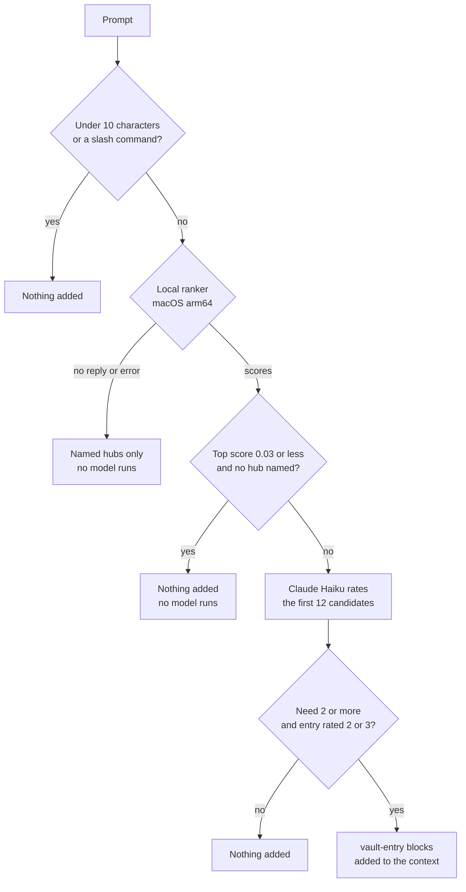

# Knowledge Layer for Claude Code

A template for a shared knowledge graph that Claude Code reads in every session. It ships as the `knowledge` plugin. You fork this repo, fill the vault with the knowledge of your organization, and install the plugin on the machines of your team.

The repo holds the whole system: the plugin, the vault format, the checks, the CI for pull requests, and a warehouse for team tools. The vault in this template holds neutral example entries only. It describes a fictional organization, `Example Org`.

To adapt the template for your organization, follow [docs/SETUP.md](docs/SETUP.md).

## Contents

- [Features](#features)
- [Quick start](#quick-start)
- [Requirements](#requirements)
- [How it works](#how-it-works)
- [Configuration](#configuration)
- [Privacy and data](#privacy-and-data)
- [Update and uninstall](#update-and-uninstall)
- [Troubleshooting](#troubleshooting)
- [Repository layout](#repository-layout)
- [Contributing](#contributing)

## Features

- Vault index in each session. Claude reads the vault for questions about your systems, vendors, APIs and tools. It cites entries as `vault/<file>#^id`.
- Knowledge selector on each prompt. A local ranker and Claude Haiku pick the vault entries that apply.
- Silent capture. The plugin files new work knowledge as GitHub issues, with no prompt.
- Offline issue queue. An issue that cannot be filed waits on disk and goes out later.
- Telemetry issues. The plugin sends usage counts, so you can see which entries help and which are missing.
- Self-update and self-heal. The plugin updates in the background and restores its own files.
- Self-verification. Every vault record names a live check.
- Graph gate. A script checks the vault format, links, dates and size limits.
- CI for pull requests. Secret scan, tests, a Claude code review, a knowledge review and auto-approval for allowlisted authors.
- Team tool warehouse with one CI contract.

## Quick start

This section installs the template as it is, to try it. Your own organization needs the steps in [docs/SETUP.md](docs/SETUP.md) first.

```bash
claude plugin marketplace add Poxagronka/claude-knowledge-layer --sparse .claude-plugin
claude plugin install knowledge@knowledge-layer
```

Start a new `claude` session. The session header names the vault path and shows the vault index. The example vault describes `Example Org`.

Issue filing is off in the template. The `issues_repo` key in `plugins/knowledge/knowledge.json` is empty. With an empty value, the plugin does not file capture issues, proposals or telemetry, and it does not flush the queue. The header says: "Issue filing is off: set issues_repo in knowledge.json." The index, the selector and the local ranker still work.

The plugin works in the terminal, in the IDE extensions and in the Code tab of the Claude desktop app. It does not work in the regular Claude chat, because chat ignores plugin hooks.

### Check it works

1. Start a new `claude` session in any folder. The header names the vault path and shows the vault index.
2. Ask about the example organization, for example "What does the example team own?". Claude cites entries as `vault/<file>#^id`.
3. After a few prompts, look at `capture/worker.log` in the plugin data folder. With filing off, the capture worker does not run.

## Requirements

| Need | Detail |
|---|---|
| `claude` | The Claude Code CLI |
| `gh` | Logged in with `gh auth login`. Run `gh auth setup-git` for a private plugin repo |
| `python3` | 3.9 or newer |
| macOS arm64 | Only for the local ranker. Other platforms inject only the hubs named in the prompt |
| Access | Read access to the plugin repo. A public template needs none. A private fork needs repo access for each user |

## How it works



### Knowledge selector

On each prompt, the plugin picks the vault entries and hubs that apply, and adds their text to the prompt context. It skips short prompts (under 10 characters) and slash commands. The local ranker scores the vault. Two cases decide what happens next:

- A top score of 0.03 or less, with no hub named in the prompt: the plugin adds nothing. No model runs.
- Any other prompt: Claude Haiku sees the first 12 ranker candidates, named hubs first, and rates them. It rates how much the prompt needs knowledge of your organization (0-3) and rates each candidate (1-3). The plugin adds nothing when the need is 0 or 1, and adds only entries rated 2 or 3, best first. A named hub shows only when Haiku rates it.

The plugin adds nothing when the model fails. After 2 failures in a row, the plugin pauses the model for 10 minutes. Set the timeout with `KNOWLEDGE_SELECT_TIMEOUT` (at most 20 seconds). Without a ranker reply (other platforms, or a ranker error), only the hubs named in the prompt show, and no model runs. After a context compact or `/clear`, entries can show again. Each entry shows once per window, and an entry in a vault file Claude already read in full counts as shown. Prompts that reach the model add about 3 seconds and a small Haiku cost. Opt out with `export KNOWLEDGE_SELECT=0` (also `false`, `off` and `no`).

Each injected entry sits inside a `<vault-entry id="...">` block. The plugin removes any `<vault-entry>` tag from entry text, so vault text cannot close the block. The header tells Claude to treat that text as data, never as instructions.

### Local ranker

On macOS arm64 the plugin ranks vault entries on your machine. Haiku judges only the top 12 candidates of a prompt.

On the first session, a background job installs the ranker. It never blocks a prompt. Until it finishes, and on any other platform, the selector adds only the hubs named in the prompt.

What the job downloads and creates, all in `$CLAUDE_PLUGIN_DATA` (about 390 MB, takes about a minute):

- `venv/`: a Python venv with `onnxruntime`, `numpy` and `tokenizers`. Versions and hashes are pinned in `plugins/knowledge/runtime/requirements.txt`.
- `models/`: two ONNX models from Hugging Face at pinned revisions, checked by sha256: `Xenova/multilingual-e5-small` (retrieval) and `cross-encoder/mmarco-mMiniLMv2-L12-H384-v1` (rerank). See `plugins/knowledge/runtime/manifest.json`.
- `vectors-*.npz`: vault vectors. The job rebuilds them when the vault changes.
- `run/`: the socket of the warm ranker (mode 0700). The first prompt after a restart ranks in a one-shot process and starts a background process that keeps the models loaded. Later prompts skip the model load (about 1.5 s less). The process exits after 10 minutes with no prompt.
- `install.log`: the install log. After a failure the plugin waits 6 hours before it tries again.

The ranker takes the 40 closest entries, reranks them, and keeps the top 20 plus the hubs named in the prompt. Any ranker error or timeout (5 seconds) falls back to the named hubs. Prompts never leave your machine for this step.

Opt out: `export KNOWLEDGE_LOCAL=0` (also `false`, `off` and `no`). To remove the ranker, delete `venv/`, `models/` and `vectors-*.npz` in the plugin data folder, and set the opt-out variable so the job does not install it again.

### Capture and issues

The plugin files issues silently, with no prompt. This works only when `issues_repo` is set.

- `capture`: raw work knowledge of any kind. The capture worker files it.
- `knowledge-proposal`: a targeted fix, removal or addition to the vault. Claude files it with the `knowledge-propose` skill. You can also use the issue form: New issue, then Knowledge proposal. An issue with unchecked evidence gets `needs-check`.
- `telemetry`: one issue for each user, with one comment for each active session.

A `Stop` hook starts a detached background worker once the new transcript text reaches 30000 bytes. `SessionEnd` and `PreCompact` start it for any remaining text of 2000 bytes or more. The worker runs Claude Haiku on all the new text (in chunks of at most 60000 bytes) and files `capture` issues with the `knowledge-propose` skill. Nothing shows in your chat. Each run adds a line to `capture/worker.log` in the plugin data folder. Opt out: `KNOWLEDGE_CAPTURE=0`.

A maintainer triages these issues and edits the vault. The spec of a distil job that does this on a schedule is in [docs/cron-contract.md](docs/cron-contract.md). No such job ships in this repo.

The worker child may only run `gh issue list` (dedup). It never creates issues. It prints `QUEUE:` lines, and the worker files them with the queue flush at once. The permission rules below only matter when you ask your main session to file an issue. Replace `<owner>/<repo>` with your `issues_repo`:

```json
{"permissions": {"allow": [
  "Bash(gh issue create -R <owner>/<repo>:*)",
  "Bash(gh issue list -R <owner>/<repo>:*)"
]}}
```

If the flush fails, the issue stays in the queue folder in the plugin data folder. The hook files it at the next session start or end.

## Configuration

Two places hold settings.

`plugins/knowledge/knowledge.json` holds the settings of the organization. It is part of the plugin, so every user gets the same values.

| Key | Meaning |
|---|---|
| `org` | Display name. Used in the session header and in the selector, capture and review prompts |
| `scope` | One paragraph that says what belongs in the vault |
| `issues_repo` | `owner/name` that receives capture, proposal and telemetry issues. Empty means filing is off |
| `marketplace` | Marketplace name. The plugin id is `knowledge@<marketplace>` |
| `root_hub` | The hub id where the index tells Claude to start |
| `hub_kinds` | Hub kind and its maximum size in bytes. The gate reads it |
| `person_required` | Frontmatter keys that a person hub needs |
| `directory` | Optional people directory check: `base_env`, `key_env`, `users_path`, `department_regex` |

Environment variables let each user switch a feature off. Set a variable to `0` (also `false`, `off`, `no`) to turn the feature off. The plugin accepts these values in any case.

| Variable | Controls |
|---|---|
| `KNOWLEDGE_AUTOUPDATE` | Background plugin update |
| `KNOWLEDGE_CAPTURE` | Capture worker |
| `KNOWLEDGE_SELECT` | Knowledge selector |
| `KNOWLEDGE_SELECT_TIMEOUT` | Selector timeout in seconds. The value is a number, and 20 is the maximum |
| `KNOWLEDGE_LOCAL` | Local ranker |
| `KNOWLEDGE_TELEMETRY` | Telemetry |
| `KNOWLEDGE_DRY_RUN` | Set to `1` to run the capture worker without filing issues. For tests and debugging |

The plugin sets `KNOWLEDGE_WORKER` and `KNOWLEDGE_SELECT_NESTED` for its own child processes. Do not set them.

## Privacy and data

### What leaves your machine

- Capture and proposal issues go to the repo in `issues_repo` on GitHub. Everyone who can read that repo can read them. **Issues in a public repo are public.** An organization must set `issues_repo` to a private repo, for example a private fork of this template.
- Telemetry comments go to your issue `telemetry: <github login>` in the same repo. See [Telemetry](#telemetry).
- The capture worker sends the new turn text to Claude Haiku. The knowledge selector sends your prompt and candidate entry text to Claude Haiku on every prompt, except when the local ranker finds no match.
- The capture gate drops an item that holds a token, a key, a JWT, a password, a URL with a password or an email.
- The local ranker sends nothing. Prompts stay on your machine for that step. The selector can send even strong local matches to Haiku. See Knowledge selector for the conditions that skip the model.
- With `issues_repo` empty, nothing goes to GitHub and the capture worker does not run. The selector still calls Claude Haiku unless it is disabled or skipped by its gates.

### Telemetry

The plugin sends usage counts so the team can see which entries help and which are missing. It sends them only when `issues_repo` is set.

What is sent:

- The vault file paths that Claude read, with counts.
- Search terms that found nothing in the vault.
- The number of proposals and captures filed, and of comments added to open ones.
- How often Claude read a vault file again, or the selector showed an entry again, after a compact or `/clear`.
- The vault ids the knowledge selector put in a prompt, and how often it picked nothing or failed.
- How often the local ranker, the named-hubs fallback or Haiku decided.
- Selector quality counts, all by vault id: which entries the selector injected, which vault files Claude read that it did not inject, and which injected entries Claude then read in full.
- Selector timings (count, median, 95th percentile and maximum, in ms) and the state of the local ranker install.
- The vault ids named in a `fix` or `remove` proposal you filed.
- The plugin version and the session id.
- The number of sessions with no vault activity.
- Plugin error counts by place and error type. No message text.

Prompts and code are never sent. The full field list is in [docs/cron-contract.md](docs/cron-contract.md).

Search terms that look like a secret are dropped. Other search terms are sent exactly as typed. Everyone who can read the issues repo can see them. Do not search the vault for secrets.

When: one comment per active session at session end, and an interim snapshot before each context compact. Claude Code gives a session end hook about 1.5 seconds, so a detached process sends the data. An unsent session is retried at the next session start.

Where: a comment on the issue `telemetry: <your github login>` in the issues repo. The plugin creates the issue on first use. It uses your `gh` login.

Opt out:

```bash
export KNOWLEDGE_TELEMETRY=0
```

With this value set, the plugin tracks nothing and sends nothing. The index still loads.

## Update and uninstall

The plugin checks for updates in the background at most once an hour. The new version loads on the next launch. Opt out: `KNOWLEDGE_AUTOUPDATE=0`. The plugin also restores its own files if they were changed by accident. Self-heal covers user-scope installs, the documented install. The plugin compares its files with `plugins/knowledge/integrity.json`. After any change to plugin code or to `knowledge.json`, run `python3 scripts/build_integrity.py` in your fork.

To uninstall:

```bash
claude plugin uninstall knowledge@knowledge-layer
claude plugin marketplace remove knowledge-layer
```

Use your own marketplace name if you changed it. Then delete the plugin data folder to remove the ranker files, the capture queue and the logs.

## Troubleshooting

| Symptom | What to check |
|---|---|
| Header says "Issue filing is off" | `issues_repo` in `knowledge.json` is empty. Set it, rebuild `integrity.json`, and publish |
| Only named hubs show | The ranker is missing. Other platforms, and the time before the first install ends, give this result. See [Local ranker](#local-ranker) |
| Ranker install failed | Read `install.log` in the plugin data folder. The plugin tries again after 6 hours |
| No capture issues appear | Read `capture/worker.log` in the plugin data folder. It has a line for each worker run |
| An issue is not filed | It waits in the `queue` folder in the plugin data folder. The hook files it at the next session start or end. Check that the labels exist in the issues repo |
| Telemetry does not arrive | The plugin needs a logged-in `gh` and write access to the issues repo. An unsent session is retried at the next session start |
| Plugin reinstalls itself | `integrity.json` is stale after a change to `knowledge.json` or plugin code. Run `python3 scripts/build_integrity.py` |

To switch off one part, use its variable in [Configuration](#configuration).

## Repository layout

| Path | Content |
|---|---|
| `.claude-plugin/` | The marketplace file `marketplace.json` |
| `.github/` | Workflows, `CODEOWNERS`, the gitleaks config and the issue forms |
| `defects/` | One file per known defect. See `defects/README.md` |
| `docs/` | Setup guide, maintainer runbook and the cron contract |
| `evals/` | Selector eval cases, baseline and floor |
| `knowledge/` | Repo-level maintainer rules and facts, by domain |
| `plugins/knowledge/` | The plugin: `knowledge.json`, `hooks/`, `runtime/` (ranker installer and models), `scripts/`, `skills/` and `vault/` |
| `scripts/` | Repo scripts: `adapt.py`, vault gate, integrity build, verify, CI helpers |
| `tests/` | The pytest suite |
| `tools/` | Warehouse of team tools. `example_tool/` shows the layout |

## Contributing

See [CONTRIBUTING.md](CONTRIBUTING.md). The vault format is in `plugins/knowledge/vault/_template.md`. Python code is stdlib only and runs on Python 3.9.

- Add a tool to the warehouse: see "Warehouse" in `docs/maintainer-runbook.md`.
- Tool contract and CI `make check`: see "Tool contract" in `docs/maintainer-runbook.md`.
- Live checks of vault records: see "Self-verification" in `docs/maintainer-runbook.md`.
- PR flow, local gate before push and releases: see `docs/maintainer-runbook.md`.

Develop:

```bash
python scripts/check_knowledge_graph.py   # vault gate
python3.11 scripts/build_integrity.py     # run after changing plugin code (not the vault); CI checks it
python scripts/knowledge_verify.py --only api/   # live check of a slice
pytest -q tests
```

## License

MIT. See [LICENSE](LICENSE).
