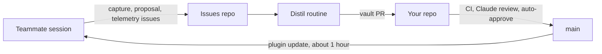

# Setup and adaptation guide

This guide turns the template into the knowledge layer of your company or project. Follow the steps in order. Each step names a command or a file and a check that tells you it worked.

The guide has one overview (this file) and five detail files. Every detail file stands alone.

| Step | File | Result |
|---|---|---|
| 1. Create your repo | this file | A private repo from the template |
| 2. Run `adapt.py` | this file | `knowledge.json`, marketplace and owners set |
| 3. Model your graph | [setup/model-your-graph.md](setup/model-your-graph.md) | Hub kinds, owner rules, a real vault, a working directory check |
| 4. Issues | [setup/issues.md](setup/issues.md) | Labels, capture, proposals, telemetry |
| 5. CI | [setup/ci.md](setup/ci.md) | Checks, Claude review, knowledge review, auto-approve |
| 6. Roll out | [setup/rollout.md](setup/rollout.md) | Install commands, install prompt, permissions |
| 7. Maintain | [setup/maintain.md](setup/maintain.md) | Distil routine, verify, fleet health, defects |

## What you build



Teammates work with Claude Code. The plugin files issues. A maintainer routine turns the issues into vault pull requests. CI checks and approves the pull requests. The merge ships the new vault to every teammate.

## 1. Create your repo from the template

Use a private repo. The plugin files raw work notes, search terms and usage counts as issues. A public repo makes them public.

```bash
gh repo create <owner>/<repo> --private --template Poxagronka/claude-knowledge-layer --clone
cd <repo>
```

If the template is not marked as a template repo, fork it with `gh repo fork Poxagronka/claude-knowledge-layer --clone` and change the fork to private in the repo settings.

Check: `git remote -v` shows your repo. `ls plugins/knowledge/knowledge.json` finds the config.

## 2. Run `scripts/adapt.py`

The script writes your organization values into three files: `plugins/knowledge/knowledge.json`, `.claude-plugin/marketplace.json` and `.github/CODEOWNERS`.

```bash
python3 scripts/adapt.py --help
python3 scripts/adapt.py \
  --org "Acme Corp" \
  --issues-repo acme/knowledge-layer \
  --plugin-repo acme/knowledge-layer \
  --marketplace acme-knowledge \
  --maintainer your-github-login \
  --root-hub org-acme \
  --dry-run
```

Remove `--dry-run` to write the files.

| Flag | Sets |
|---|---|
| `--org` | `org` in `knowledge.json`. Required |
| `--issues-repo` | `issues_repo` in `knowledge.json`. Required. Use a private repo |
| `--plugin-repo` | The git URL of the plugin in `marketplace.json`. Default: the value of `--issues-repo` |
| `--marketplace` | `marketplace` in `knowledge.json` and the name in `marketplace.json`. The plugin id becomes `knowledge@<marketplace>` |
| `--maintainer` | Every login in `.github/CODEOWNERS` |
| `--root-hub` | `root_hub` in `knowledge.json`. Rename the hub file to match (see step 3) |
| `--dry-run` | Prints the files that would change and writes nothing |

The script does not touch the vault, the docs or `integrity.json`. After it runs, do two more things.

1. Review `plugins/knowledge/knowledge.json`. Write the `scope` paragraph. It says what belongs in the vault, and the selector and capture prompts use it. Set the `directory` block or plan to remove it (see step 3).
2. Rebuild the integrity list. The installed plugin hashes `knowledge.json` and compares it with `integrity.json`. A stale list makes every install look broken and triggers a reinstall.

```bash
git add -A
python3 scripts/build_integrity.py
python3 scripts/build_integrity.py --check
```

The script lists tracked files with git, so run `git add -A` first. Run it again after every edit to `knowledge.json` or plugin code.

Check: `python3 scripts/check_knowledge_graph.py` exits 0. `pytest -q tests` passes. The selector eval test `test_baseline_matches_selector_code` needs a fresh baseline after you change vault content. See [setup/maintain.md](setup/maintain.md).

## 3 to 7. Continue in the detail files

Work through the table at the top. Do step 3 before you publish. Steps 4 and 5 need admin rights on the repo. Step 6 needs the repo to be pushed.

## Final checklist

Copy this list into an issue and tick each line.

Repo and config
- [ ] The repo is private and created from the template.
- [ ] `adapt.py` ran. `knowledge.json` has your `org`, `scope`, `issues_repo`, `marketplace` and `root_hub`.
- [ ] `.github/CODEOWNERS` lists your maintainers.
- [ ] `build_integrity.py --check` passes.

Vault
- [ ] The stub hubs are replaced or deleted. No `example` or `Jane Doe` text is left.
- [ ] `_template.md` owner rules and `_index.md` describe your organization.
- [ ] `python3 scripts/check_knowledge_graph.py` exits 0.
- [ ] Every record has a `verify_with` value that you can run, or `none` with a reason.
- [ ] The `directory` check works, or `directory` is removed and no record uses `directory:`.
- [ ] `evals/select_cases.jsonl` has cases for your hubs. `evals/baseline.json` is rebuilt.

Issues
- [ ] The labels `capture`, `knowledge-proposal`, `needs-check` and `telemetry` exist in the issues repo.
- [ ] Teammates have Triage access or higher on the issues repo.
- [ ] You filed one test issue with `gh issue create` and closed it.

CI
- [ ] The secret `ANTHROPIC_API_KEY` is set.
- [ ] The variable `REVIEW_AUTHORS` holds a JSON array of logins.
- [ ] Settings allow Actions to approve pull requests, and allow auto-merge.
- [ ] Branch protection on `main` requires the checks `gitleaks`, `knowledge`, `meta` and `tools`, and one approval.
- [ ] The first pull request merged. A second pull request from an allowlisted author was approved by the bot.
- [ ] The `fleet-health` workflow ran once by hand.

Roll out
- [ ] One teammate installed the plugin and saw `<org> knowledge vault` in the session header.
- [ ] The install prompt and the permission allowlist are in your onboarding doc.
- [ ] A maintainer owns the distil routine and the weekly verify run.
