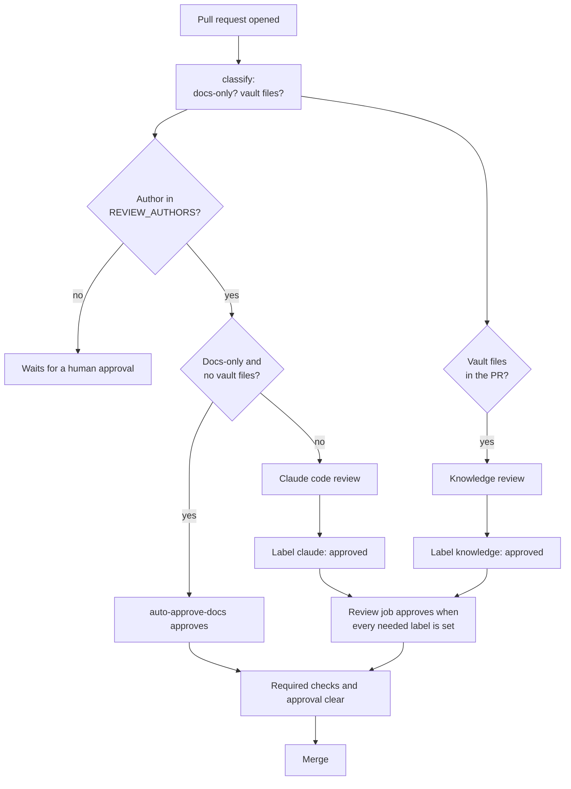

# Step 5: CI, review and auto-approve

The template ships five workflows. Together they check every pull request, review it with Claude, and approve it for trusted authors. A merge then ships the change to your team.

Contents: [The workflows](#the-workflows), [Pull request flow](#pull-request-flow), [One-time setup](#one-time-setup), [Branch protection](#branch-protection), [Bootstrap](#bootstrap-the-first-approval), [Auto-merge](#auto-merge-optional), [Secret scan](#secret-scan), [Warehouse tools](#warehouse-tools-contract), [Rules to keep](#rules-to-keep).

## The workflows

Each workflow file starts with a comment that lists the secrets, variables and labels it needs.

| File | Trigger | Job names | What it does |
|---|---|---|---|
| `check-pr.yml` | `pull_request` | `gitleaks`, `knowledge`, `meta`, `units`, `tool`, `tools` | Secret scan, ruff, vault gate, integrity check, tests, workflow lint, manifest validation, tool checks. Gets no secrets |
| `claude-review.yml` | `pull_request_target` | `classify`, `review`, `knowledge-review` | Claude code review and the knowledge review. Sets labels and approves |
| `auto-approve.yml` | `pull_request_target` | `auto-approve`, `auto-approve-docs` | Approves from labels, and approves docs-only pull requests directly |
| `fleet-health.yml` | Weekly cron, manual | `report` | Reads telemetry comments, prints a report, fails on an alert |
| `dependabot.yml` | Dependabot | none | Monthly updates of the pinned GitHub Actions |

## Pull request flow



Rules of the flow:

- Only authors in `REVIEW_AUTHORS` get a review or an auto-approval. Others wait for a human. This includes Dependabot.
- A docs-only pull request (markdown, `docs/`, `knowledge/`, `defects/`) skips the code review. `auto-approve-docs` approves it.
- A pull request that touches `plugins/knowledge/vault/` gets the knowledge review. It checks format, evidence and scope against the owner rules in `_template.md` and the `org` and `scope` in `knowledge.json` at the base commit. A vault-only pull request skips the code review and needs only `knowledge: approved`.
- A code pull request gets the Claude code review. It needs `claude: approved`. With vault files too, it needs both labels.
- Each review agent writes `.review-ctx/verdict.json` with a verdict and the head SHA. The agent holds no label or API write tool. A trusted step reads the file, sets the label and approves. A missing or invalid file counts as `changes needed`. A file for another SHA is ignored.
- A new push clears the labels and starts the review again on the new head. The review waits 3 minutes first, so rapid pushes cost nothing.
- When a push leaves the code diff unchanged, the review is carried forward by `git patch-id`. No model runs.
- The approval is pinned to the reviewed commit.

## One-time setup

All commands use the `gh` CLI with admin rights on `<owner>/<repo>`.

**Secret.** Create an Anthropic API key for the review jobs. Only `claude-review.yml` uses it.

```bash
gh secret set ANTHROPIC_API_KEY -R <owner>/<repo>
```

`gh` asks for the value. Never put the key in a file in the repo.

**Variable.** The author allowlist is a JSON array of GitHub logins. An empty or missing value means nobody gets a review or an approval.

```bash
gh variable set REVIEW_AUTHORS -R <owner>/<repo> --body '["alice","bob"]'
```

Add the login of a maintainer. Add the logins of people who open vault pull requests. Add the login that your distil routine uses to open pull requests.

**Actions settings.** In the repo, open Settings, Actions, General.

- Workflow permissions: choose "Read repository contents and packages permissions".
- Tick "Allow GitHub Actions to create and approve pull requests". The workflows approve with `GITHUB_TOKEN`. Without this setting the approval call fails.

**Merge settings.** In Settings, General, Pull Requests, tick "Allow auto-merge". Choose squash merge.

**Labels.** The review workflows create `claude: approved`, `claude: changes needed`, `knowledge: approved` and `knowledge: changes needed` on the first run. To create them early:

```bash
for l in "claude: approved" "knowledge: approved"; do gh label create "$l" -R <owner>/<repo> --color 0E8A16 --force; done
for l in "claude: changes needed" "knowledge: changes needed"; do gh label create "$l" -R <owner>/<repo> --color D93F0B --force; done
```

## Branch protection

Protect `main` after the first push. Require the four stable check names and one approval. Use a full `PUT`. A `PATCH` of the required checks returns 404 when none exist yet.

Write the rule to a file:

```bash
cat > /tmp/protection.json <<'JSON'
{
  "required_status_checks": {"strict": false, "contexts": ["gitleaks", "knowledge", "meta", "tools"]},
  "enforce_admins": false,
  "required_pull_request_reviews": {"required_approving_review_count": 1, "require_code_owner_reviews": false},
  "restrictions": null
}
JSON
gh api -X PUT repos/<owner>/<repo>/branches/main/protection --input /tmp/protection.json
```

| Check | Meaning |
|---|---|
| `gitleaks` | Secret scan |
| `knowledge` | ruff, vault gate, integrity check, pytest |
| `meta` | actionlint and plugin manifest validation |
| `tools` | Aggregate of the per-tool matrix |

Never require `tool (...)` directly. Its names change with the pull request, so a required matrix name stays pending forever. `tools` always runs and is the stable name.

Later, set `require_code_owner_reviews` to `true` and add maintainers to `.github/CODEOWNERS`. Branch protection on a private repo may need a paid GitHub plan. Check your plan.

## Bootstrap the first approval

The approval bot cannot approve a change to its own rules. Plan these manual steps once.

1. Push the adapted template straight to `main` before you turn on protection. The workflows then exist on `main`.
2. Set the secret and the variable. Turn on branch protection.
3. Open a small pull request from an account in `REVIEW_AUTHORS`. A docs-only change is cheapest, for example a typo in `docs/`. `auto-approve-docs` approves it. Merge it.
4. Open a code pull request, for example a tool change. Watch the Claude review run and the label appear.
5. If a pull request does not get approved, approve it by hand with a second human account. GitHub does not let an author approve their own pull request.

`pull_request_target` runs the workflow files from the base branch. So a pull request that changes `claude-review.yml` or `auto-approve.yml` is judged by the version on `main`, and its changes take effect after merge. The pull request that first switches a repo from `pull_request` to `pull_request_target` is reviewed by neither version. It needs one manual approval. The template already uses `pull_request_target`, so you meet this case only if you change the trigger.

If approvals break, open a revert pull request, ask another admin to approve it, and merge. Never admin-merge a normal change.

## Auto-merge (optional)

The template does not merge for you. The author sets auto-merge once, and GitHub merges when the checks pass and the bot approves:

```bash
gh pr merge <number> --squash --auto
```

To merge without that step, add a workflow like this one as `.github/workflows/auto-merge.yml`. It is an example and is not in the template. Test it on a throwaway pull request.

```yaml
name: Auto merge
on:
  pull_request_target:
    types: [opened, reopened, synchronize, ready_for_review]
permissions:
  contents: write
  pull-requests: write
jobs:
  enable:
    if: >-
      !github.event.pull_request.draft &&
      contains(fromJson(vars.REVIEW_AUTHORS || '[]'), github.event.pull_request.user.login)
    runs-on: ubuntu-latest
    steps:
      - env:
          GH_TOKEN: ${{ github.token }}
          PR: ${{ github.event.pull_request.number }}
          REPO: ${{ github.repository }}
        run: gh pr merge "$PR" -R "$REPO" --squash --auto
```

The job does not check out the pull request, so it runs no pull request code. Branch protection still holds the merge until the required checks pass and the bot approves.

## Secret scan

The `gitleaks` job downloads a pinned gitleaks release, checks its sha256, and scans the whole git history with `.github/config/gitleaks.toml`. The config extends the default rules. It has no global allowlist, because a regex allowlist hides every match it fits. A false positive gets the inline marker `gitleaks:allow` on its line, with the reason in the pull request body.

The config comes from the pull request head. A pull request can change the rules it is scanned with, so review any change to this file. `CODEOWNERS` lists it under `/.github/`.

## Warehouse tools contract

The `tools/` folder holds small team tools. CI checks only the tools that a pull request changes.

- A tool folder has a `Makefile` with a `check` target. `tools/example_tool/` is the model.
- `make check` must work on a clean `ubuntu-latest` runner, with python3, node, go, rust and uv installed. The target installs its own dependencies.
- Optional: set `CI_SHARDS = N` (1 to 16) to split the work. CI runs one job per shard and passes `SHARD` (1-based) and `SHARDS`.
- A folder with only markdown (for example a skill) needs no `Makefile`.
- A folder with code and no `check` target fails the `units` job.
- CI picks the nearest `Makefile` above each changed file, never above the top-level folder.
- Top-level folders `plugins`, `scripts`, `tests`, `docs`, `evals` and any folder that starts with a dot belong to the repo. They are never tools.

Add a hub `tool-<name>.md` for each tool. See [model-your-graph.md](model-your-graph.md).

## Rules to keep

- Run review and approval on `pull_request_target`. Run jobs that execute pull request code on `pull_request`, with no secrets.
- Pass `github_token: ${{ secrets.GITHUB_TOKEN }}` to `claude-code-action` under `pull_request_target`. Its default App auth fails there.
- Approve in the same job that sets the verdict label. Events made with `GITHUB_TOKEN` do not trigger other workflows.
- Do not set `track_progress` on `claude-code-action` under `pull_request_target`. It checks the pull request head out into the workspace root.
- A missing verdict must fail the job. A job that passes without a verdict hangs the pull request.

The reasons are in `knowledge/github/rules.md`.
